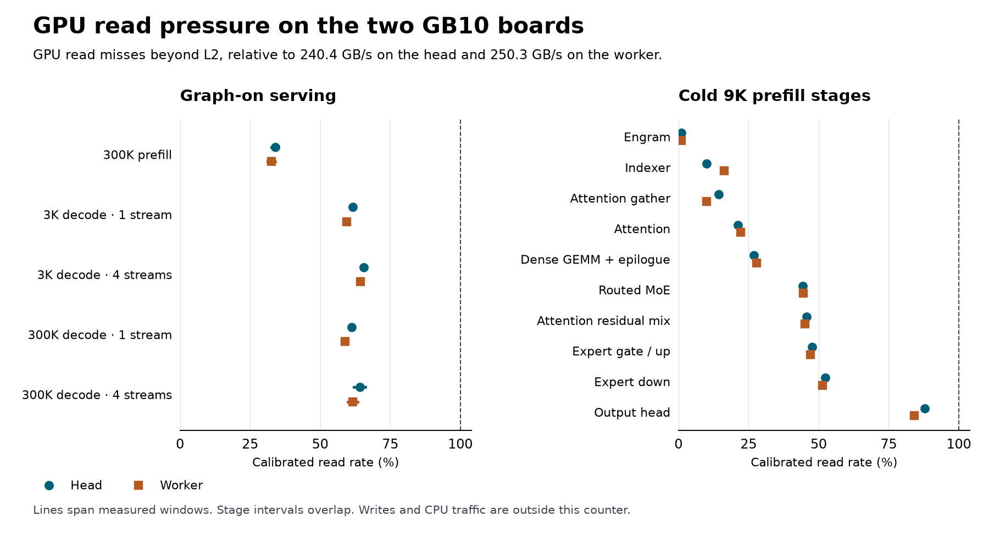

# GB10 overnight engine evaluation, November 17–18

## Runtime decisions

| Serving priority | Measured choice |
| --- | --- |
| Short concurrent output | Pinned deployed recipe. Four active 3K requests delivered 136.5–138.4 tok/s, versus 130.4–134.2 with all eight warm switches. |
| Cold prefill at 32K and 100K | The pinned eight-switch unkeyed arm improved input throughput 5.1–5.5% and 3.9–4.3%, with four-user output losses at both depths. |
| Long, repeated chat histories | The 32 MiB token cache saved 445–508 ms of first-token latency at 500K. The eight-switch bundle improved four-user 300K median TTFT on both seeds, with a small output-rate cost. |
| Retained-state pressure | On a rebuilt trim-capable image, snapshot trimming eliminated all eight disk restores in the 84-session crossover. Keep ten-second held-prefix patience and fixed finish grace for general serving. |
| Arithmetic and bandwidth | Four-stream routed experts reached 93–96% of scattered-read throughput. Inclusive graph-on decode reached 58–64% of measured per-board streaming reads. Cold dense prefill reached 35% of matched arithmetic throughput on the head and 67% on the worker. |
| Quality-sensitive serving | Keep uncapped T13, keyed drafts, L2 prefetch and fetch-mode KV. The faster eight-stream expert cap failed both independent likelihood gates and lost the solved SQL case. |

The tables below give per-workload timings, counter coverage and reproduction files. Persistent serving settings are recorded in the [configuration record](../../best-runtime.md).

## Serving baseline

The deployed control is the two-rank serving recipe on image `234f9080b326`. On the earlier combination image, the eight-switch warm-serving candidate increased diverse uncached prefill throughput by 6.9% at 8K, 5.3% at 32K and 4.1% at 100K across three rotated passes. The sustained prefill gain was about 4%. Short decode improved about 0.5–1%. On the pinned serving image, identical warm inputs at 4K and 100K reached first token 5.8% and 4.9% sooner. Their output rates changed by −1.7% and +1.1%, respectively. The isolated 32 MiB tokenizer cache saved 445–508 ms on 500K conversation appends. Mapping scales adds about six seconds to the first request after startup. These comparisons have different denominators and workloads. [Configuration and evidence](../../best-runtime.md)

In the November 13 external interval, 652 completed requests supplied 91.64 million prompt tokens, reused 89.68 million (97.9%), and generated 436,994 output tokens. Their **24,930.6 summed request-seconds** comprised 21,520.3 s of decode (86.3%), 2,549.7 s of reported prefill (10.2%) and 860.6 s of other time to first token (3.5%). The last category includes work the historical log cannot separate. Among the 80 requests of at least 250K tokens the prefill share rose to 21.8%. Concurrent requests contribute their own elapsed time to this accounting. These are workload weights for this interval, distinct from device utilization. [Aggregate fields and depth cohorts](traffic-stages.json)

### Same-image production crossover at 3K and 300K

The deployed recipe bracketed the eight-switch warm candidate on the same pinned image, with serving graphs, speculation and a fresh private spill directory in each process. All **20 warm responses** matched across the three arms in input, grid cut, output length and token hash. Starting occupancy matched in every cell, and placement refused zero requests. The table compares delivered output during the period when all requested streams were generating. Ranges span the two fixed seeds. Each percentage first compares a seed to the midpoint of its two production controls.

| Context and streams | Deployed output tok/s | Eight switches, output tok/s | Mean paired change | Warm median TTFT changes, two seeds |
| --- | ---: | ---: | ---: | ---: |
| 3K × 1 | 66.7–77.4 | 66.5–76.5 | −0.9% | −4.4%, −5.4% |
| 3K × 4 | 136.5–138.4 | 130.4–134.2 | **−3.5%** | −4.9%, +0.1% |
| 300K × 1 | 71.8–79.7 | 69.5–81.1 | −0.8% | +11.6%, −22.4% |
| 300K × 4 | 131.5–137.5 | 128.7–136.9 | −1.2% | **−4.2%, −11.2%** |

For 3K × 4 the candidate's physical round time increased **6.9% and 5.0%**. Both output samples fell below both controls for the same seed. At 300K × 4 the worst-user TTFT in the second repeat fell from 4.88–4.89 s to 4.46 s, while the first repeat was within 0.06 s of both controls. End-to-end, the 3K four-user batches finished 2.8% and 1.4% later on the candidate. At 300K the four-user batch finished 1.9% later and 1.5% sooner across the two repeats. This supports retaining deployed settings when short four-way throughput is the priority. The token-cache and first-token results support a distinct long-chat latency configuration. [Matched rounds and tokens](followthrough02/baseline-pairs.csv) · [Cold and warm latency measurements](followthrough02/baseline-comparison.json)

The first 300,018-token prompt in each process had zero reuse and ran at **1,931 / 1,910 / 1,913 input tok/s** in deployed / candidate / deployed order (−0.6%). The later uncached 3,058-token prime reached **1,653 / 1,322 / 1,661 tok/s** (−20.2%, one prime per arm). These two prime costs include different startup and cache histories from the older rotated prefill campaign. Extrapolating the historical 4–7% prefill gain to the pinned image or all context lengths would overstate current performance.

### Pinned configuration attribution and keyed drafts

Six fresh processes on the pinned image ran a shallow-only sequence with deployed controls first and last, two sampler seeds, identical 2,048-token warm cuts, serving graphs and speculation. Every candidate reproduced all ten warm outputs and all four zero-cut cold outputs against both controls. Starting occupancy matched, with zero placement refusals. Values below show the two seeds in order, compared to the midpoint of their own controls. The initial deployed arm delivered 137.0/138.7 tok/s at width four, the returning deployed arm 137.9/137.6. Each arm's absolute rates and faster-control comparisons are in the [paired rate ledger](followthrough02/config-crossover/short-summary.csv).

| Additions to deployed recipe | Warm 3K × 1 output | Warm 3K × 4 output | Cold 3K input | Cold 8K input |
| --- | ---: | ---: | ---: | ---: |
| Tokenizer cache only | +0.9% / 0.0% | −0.1% / −0.2% | +0.2% / +0.4% | +0.6% / +0.2% |
| Cache and three Engram switches | −2.3% / +0.6% | −4.1% / −2.1% | −7.3% / +1.4% | −24.1% / +7.0% |
| All eight, keyed drafts | −4.0% / −0.5% | −10.6% / −1.4% | −4.2% / −2.7% | +4.9% / +6.6% |
| All eight, unkeyed drafts | −5.9% / −15.4% | −10.4% / −8.7% | −3.8% / +1.7% | +6.2% / +5.9% |

The token cache alone preserves short performance in this panel and saves 445–508 ms on immutable 500K histories. The three Engram additions account for some of the short four-user loss. Adding the four GPU switches to that host configuration changed four-user output by −6.8% and +0.8% depending on seed. This grouped comparison does not assign an effect to an individual GPU switch. The earlier mixed-depth crossover also favored deployed short four-way decode.

With all eight switches present, disabling keyed drafts lowered delivered tokens per stream per physical round on both seeds, from 2.90/2.29 to 2.72/1.94 solo and 2.56/2.43 to 2.34/2.23 four-way. Output throughput changed −2.0%/−15.0% solo and +0.2%/−7.5% four-way relative to keyed. Keep keyed drafting for warm generation. Both eight-switch arms passed the cold 8K gate. Unkeyed was selected for the full crossover by its higher minimum gain versus the faster deployed control, +5.68%. The cold result compares whole configurations and cannot attribute the gain to the drafting switch. [Round and output ledger](followthrough02/config-crossover/paired.json) · [Gate](followthrough02/config-crossover/expanded.json)

### Full 32K and 100K confirmation

The selected eight-switch unkeyed arm beat the **faster** deployed control on both cold prompts by 5.08%/4.97% at 32K and 3.91%/3.68% at 100K. Cold requests used zero cached tokens. All four cold and all 20 warm outputs matched both controls. All warm cuts and starting occupancies matched, with zero placement refusals. The two cold panels use 16 output tokens and measure the server's prefill stage. Warm output rates measure the interval with all requested streams generating. [Absolute rates and both controls](followthrough02/config-crossover/full-summary.csv) · [Warm round and placement ledger](followthrough02/config-crossover/expanded-pairs.json)

| Workload | Deployed rate, tok/s | Selected rate, tok/s | Change against midpoint, by seed |
| --- | ---: | ---: | ---: |
| Cold 32K input | 1,957–1,972 | 2,070–2,072 | +5.49% / +5.12% |
| Cold 100K input | 1,932–1,949 | 2,021 | +4.26% / +3.89% |
| Warm 32K, solo output | 67.7–69.1 | 60.8–61.2 | −11.42% / −10.12% |
| Warm 32K, four-user output | 129.5–137.7 | 122.3–126.9 | −5.87% / −7.62% |
| Warm 100K, solo output | 69.1–71.6 | 71.7–73.4 | +2.94% / +2.57% |
| Warm 100K, four-user output | 130.8–135.1 | 119.3–123.9 | −11.64% / −5.50% |

The bundle qualifies for prefill-heavy 32K/100K workloads prioritizing input throughput. Keep the deployed settings plus the tokenizer cache and keyed drafting for mixed short decode and long retained chats. The short keyed and unkeyed bundles both passed the 8K prefill screen. The full test selected one using the preregistered minimum-gain rule and therefore leaves their direct 32K/100K prefill difference unresolved.

The last benchmark restored the original image, flags and spill mounts on both ranks. The production startup smoke needed one retry, and the full validation then reproduced eight of eight saved replies and eight of eight concurrent-to-solo comparisons. At 08:57 Pacific both fingerprints matched the original, with zero clients waiting or connected and no failed or stalled pair. [Validation](followthrough02/config-crossover/production.validate.log) · [Independent health check](followthrough02/final-health.json)

## Snapshot availability under 300K pressure

At the production 2,048-token snapshot floor, the guarded 500 ms policy checks that both ranks have committed a candidate's point before reclaiming it early. An injected follower-only omission left the head copy intact. Three other histories had confirmed backups on both ranks.

| Four requests | Comparison | Longest queue | First return to the missing-peer session | Burst and three returns |
| --- | --- | ---: | ---: | ---: |
| 384 output tokens each | Deployed 10 s | 13.149 s | 1.167 s | 29.163 s |
| Same | Unconditional 500 ms | 7.903 s | 152.260 s | 179.827 s |
| Same | Guarded 500 ms | 6.235 s | 1.031 s | 24.671 s |
| 1,024 each, reversed arrival order | Unconditional 500 ms | 5.979 s | 151.289 s, zero reused | 194.636 s |
| Same | Guarded 500 ms | 5.989 s | 1.385 s, 296,960 reused | 49.712 s |
| 384 each, fully backed | Unconditional 500 ms | 5.896 s | 1.226 s, 296,960 restored | 24.658 s |
| Same | Guarded 500 ms | 6.058 s | 1.873 s, 296,960 restored | 30.548 s |

Both 1,024-token arms completed identical incoming requests, with matched cuts, lengths and output hashes. At 1,024 tokens the guard cost 4.749 s of burst wall but saved 144.924 s across the whole sequence. On fully backed sessions the guard cost 5.890 s across the sequence. Its sole affirmative lookup took 0.497 ms, which accounts for little of that gap. Each comparison has one paired run. Preparation also differed in the fully backed case. The plain arm cold-filled the last history in 158.72 s, whereas the guard arm restored it in 1.94 s. Both had identical retained rows and proven copies before timing. The 5.890 s difference therefore cannot be attributed to the guard. [Long-output results](kv/committed-long.json) · [Fully backed results](kv/committed-healthy.json) The 384-token guard passed the 39-case exact suite. Production traffic frequency determines the aggregate value of the avoided miss. [Armed crossover and confirmations](kv/RESULTS.md#proof-of-a-committed-point-on-the-pair)

The reverse-order **matched all-warm** repeat restored all four histories before timing. Preparation took 19.253 s guarded and 19.399 s plain. The arms entered with identical per-part rows, then reproduced all four 384-token outputs. The burst and three returns took **29.356 s guarded versus 30.144 s plain**, with maximum queue 6.056 versus 6.387 s. The earlier apparent 5.890 s healthy penalty disappeared under matched preparation. A single pair cannot distinguish a 0.788 s advantage from run variation. [All-warm crossover](kv/committed-warm01.log)

The peer check introduces a degraded-link cost. In the two-rank CPU loopback an 80 ms delayed positive reply blocked the caller for 80 ms. A reply delayed 10.6 s triggered the normal timeout at 10.010 s, marked the spill pair broken and invoked its callback. The installed native callback requests a drain of serving. That final drain behavior was verified in source. The timed test used a callback spy. A second host experiment showed that a follower can expire a previously confirmed point while it publishes an earlier write. The head still held its copy and had sent no intervening keep or forget. Caching a previous affirmative answer at the head would therefore admit a false positive. A host prototype bound a point to a short-lived retention agreement. While its follower was busy for 80 ms, 1,000 local checks took 111 µs in total. Serving integration still needs asynchronous acquisition, epoch invalidation and a cross-machine clock bound. [Prototype and retention tests](kv/RESULTS.md#bounded-metadata-lease-on-the-real-cpu-store) Keep this synchronous guard experimental. [Autonomous expiry test](kv/committed-build/async-invalidation.log) [Loopback fault evidence](kv/committed-build/delayed-peer.log)

### Natural completion at 300K

The lead stopped naturally at 142 tokens under a fixed 166-token limit. Three followers arrived 0.20, 0.55 and 0.90 s after its first token. All five policies returned identical outputs and reused the same 299,008-token cuts. Fixed 10 s held patience and fixed finish grace bracketed the lead at 3.470–3.529 s with 135–140 ms maximum stream gaps and 14.021–14.068 s maximum follower queue. Short-held fixed grace cut maximum queue to 4.770 s while preserving a 3.484 s lead and a 133 ms maximum gap. Switching that same short-held setting to adaptive grace lengthened the lead to 10.815 s, with a 2.236 s maximum gap. Ten-second patience with adaptive grace also worsened the lead, to 6.347 s and a 1.821 s gap. No adaptive extension was logged. The fixed and adaptive rules offer different initial protection even with zero extensions. Retain fixed grace for this workload. The fully backed natural case favors shorter held patience; the selective missing-copy results above determine the risk of applying it generally. [Five-arm evidence](kv/natural01.log) · [Armed exact](kv/natural01/short-adaptive.exact-compare.log)

After timing, the isolated tier held 25 committed manifests per rank. Retaining the 296,960-token victim required 259.570 MiB on the owner and 55.664 MiB on its peer (315.234 MiB coupled). A 299,008-token point required 261.316 plus 56.004 MiB (317.320 MiB). Accounting for sharing and hard links left the same marginal logical sizes for those individual points. These figures price a possible durable retention lease. [Private tier census](kv/natural01/lease-footprint.json) The 296,960-token f3 restores reported 161–178 ms in the four warmed fills/revisits. Reading a full 259.570 MiB owner footprint at its independently measured 2.42 GB/s sequential direct-read rate would take 112 ms. The tier can use the operating-system cache and shared blocks. The comparison prices the logical payload and does not establish physical NVMe utilization. [Restore timings](kv/committed-warm01.log) · [Local storage reference](hardware01/head-drive.jsonl)

## Pruning throughput and quality at eight active streams

Keep the current uncapped pruning rule. With cap `12,1`, SQL/tool generation reached 210.0/165.6 tok/s versus 151.6–156.3/126.5–127.6 tok/s in the two current controls. At eight continuously active streams, SQL physical rounds were 88.16–90.08 ms under current and 60.04 ms under the cap. Tool rounds were 76.31–77.77 ms and 52.34 ms. The dropped route-weight share rose from about 11% to 39–40%. All eight capped SQL answers exhausted their budgets before producing SQL. Current solved one SQL case and two complete tool episodes. Both cap and prune-off lost that SQL case and solved the same two tool episodes. The cap passed four of eight saved validation replies and matched zero of eight concurrent replies to their solo counterparts.

The cap increased negative log likelihood by 0.02665 nats/token on the original 20 source files (95% source-paired interval 0.00593–0.04736) and by 0.03935 on 20 disjoint files (0.01073–0.06796). Both failed the +0.020 upper-bound criterion. The returning current control reproduced all 80 item scores and all 40 SQL/tool-turn hashes. A higher-budget SQL test would measure whether additional output time recovers task success, with a different latency and quality trade-off. [Width-eight scores, work and routing](prune/RESULTS.md)

## What the hardware reference can measure

Each Spark has a separate memory system. Lam describes 48 GPU SMs, a 24 MB GPU L2 and a 16 MB system-level cache ahead of shared LPDDR. A repeated L2-resident read on this pair reached 1.4–2.2 TB/s. A working set larger than either cache and an address pattern resembling the actual weights are important when estimating a DRAM ceiling. Compute, host work, storage, remote transfers and waiting can all limit a request while memory is idle. The supplied local Reader View file contained only browser controls, so the topology comes from the published article. [GPU topology](https://chipsandcheese.com/p/analyzing-nvidia-gb10s-gpu) · [CPU and system cache](https://chipsandcheese.com/p/inside-nvidia-gb10s-memory-subsystem) · [Board specification](https://docs.nvidia.com/dgx/dgx-spark/hardware.html) · [Pair-local probe](../w4/RESULTS.md)

| Reference operation, per board | Decimal GB/s | Share of 273 GB/s | Source and date |
| --- | ---: | ---: | --- |
| 256-bit LPDDR5X-8533 interface | 273 | 100% | [NVIDIA specification](https://docs.nvidia.com/dgx/dgx-spark/hardware.html), read Nov 7 |
| GX10 clpeak float4 global read, OpenCL / Vulkan / CUDA, driver 580.159.03 | 246.8 / 242.3 / 244.5 | 89–90% | [GX10 measurements](https://forums.developer.nvidia.com/t/ubuntu-26-04-drivers-610-cuda-toolkit-13-3-zfs-on-gx10/373655/8), Jun 25 |
| Same test, Ubuntu 26.04 and driver 610.43.02 | 246.1 / 242.8 / 244.4 | 89–90% | [GX10 measurements](https://forums.developer.nvidia.com/t/ubuntu-26-04-drivers-610-cuda-toolkit-13-3-zfs-on-gx10/373655/8), Jun 25 |
| CUDA 13 STREAM triad, five units | 200–213 | 73–78% | [nvfp4bench](https://forums.developer.nvidia.com/t/gb10-really-does-hit-1-pflop-nvfp4-2-4-sparse-measured-with-an-open-source-tool-to-reproduce-it/373618), Jun 17 |
| PyTorch device copy, driver 580.178.04 | 216–218 | 79–80% | [Device-copy report](https://forums.developer.nvidia.com/t/dgx-spark-gb10-magistral-24b-bf16-4-85-tok-s-gemv-decode-allocation-and-ncu-resource-errors/386351), Oct 20 |
| memtest_vulkan 0.6.0 write / verify-read over 92 GB, DGX OS then Ubuntu 26.04 | 177 / 193 then 178 / 215 | 65–79% | [OS comparison](https://forums.developer.nvidia.com/t/ubuntu-26-04-drivers-610-cuda-toolkit-13-3-zfs-on-gx10/373655), Jun 17 |
| GPU reads during CPU contention | 231 | 85% | [Chips and Cheese](https://chipsandcheese.com/p/inside-nvidia-gb10s-memory-subsystem), Dec 31, 2025 |
| Cache-bypassing UMA read / write | 165.7 / 115.9 | 61% / 42% | [uma_bw](https://forums.developer.nvidia.com/t/gb10-hardware-baseline-first-direct-measurements-and-findings/367851), Apr 26 |
| One X925 / A725 CPU core reading DRAM, one cluster | 38 / 26, cluster over 100 | 14% / 10% | [Chips and Cheese](https://chipsandcheese.com/p/inside-nvidia-gb10s-memory-subsystem), Dec 31, 2025 |
| Dell Pro Max tinymembench single-thread memcpy / memset | 31.9 / 86.9 | 12% / 32% | [Jeff Geerling](https://github.com/geerlingguy/sbc-reviews/issues/92), Nov 21, 2025 |
| CPU/GPU view copy, Vulkan host-to-device / CUDA pinned | 122.7 / 58.9 | Transfer API | [GX10 measurements](https://forums.developer.nvidia.com/t/ubuntu-26-04-drivers-610-cuda-toolkit-13-3-zfs-on-gx10/373655/8), Jun 25 |
| Pair-local scattered GPU weight reads | 231–236 | 85–86% | [Engine probe](../w4/RESULTS.md), prior campaign |

The installed GB10 CUPTI PM-sampling catalog exposes L2-sector events. It lists no DRAM read/write byte counters or memory-controller traffic group. A miss can hit the system cache and L2 write lookups do not measure physical writeback. The following measurements quantify GPU reads leaving L2. The head's Linux perf event sources exposed CPU and SMMU units. The NVIDIA driver reported the memory clock and supported clock list as unavailable. An independent pair on driver 580.159.03 reported similar limits. Exact LPDDR bus utilization, including CPU traffic and writes, remains unknown. [Independent GB10 counter survey](https://forums.developer.nvidia.com/t/are-memory-controller-or-c2c-performance-counters-available-on-gb10-dgx-spark/388829) [Installed metric catalog](hardware01/pm-metrics.txt)

The external microbenchmark values are those supplied for this evaluation. Percentages below use per-board rates. Throughput at the HTTP endpoint includes work on both ranks.

## Stage measurements

| Stage | Measurement and interpretation |
| --- | --- |
| Tokenization and chat rendering | Three paired 500K append sizes saved 445–508 ms TTFT with the tokenizer cache. Saved encoding work is directly measurable. A CPU streaming GB/s comparison needs actual read traffic and core placement. |
| Admission and KV placement | The 10 s patience control queued the final 300K caller for 24.80 s with the eight warm switches. An immediate revisit to an evicted 299,008-token prefix with zero committed snapshots took 153.80 s to first token compared with 1.48 s when resident. This observation was under the control itself. The selective paired comparison below measured an additional 151.43 s on the returning victim under the shorter deadline. [Pressure trials](kv/RESULTS.md) |
| Prefill | In a previous 24-chunk mixed-size profile, routed MoE averaged 369 ms/chunk, attention 197 ms, Engram 158 ms and the two gathers 46 and 47 ms. Sizes ranged from 263 to 31,388 prompt IDs. The cold 9K and 300K counter studies below quantify read pressure. At 9K, measured dense projection throughput reached 35% of the same-shape reference on the head and 67% on the worker. [Prefill profile](../w4/RESULTS.md) |
| Routed MoE decode | The counter-derived 221–222 GB/s per rank equals approximately **94–96% of the measured 231–236 GB/s scattered-read roof**, 90–91% of the supplied CUDA contiguous-read result, and 81% of the 273 GB/s specification. For the single-stream cell, 3.587 GB at 231–236 GB/s takes 15.20–15.53 ms, versus 16.15 ms observed. The implied removable portion at unchanged traffic and this roof is 0.62–0.95 ms of the 36.29 ms eager step. Counters were collected separately from timing to avoid synchronization distortion. The eight-stream byte estimate extrapolates four-stream bytes/place. [Bytes, timings and calibration](../w4/RESULTS.md) |
| Engram reads and staging | Per-request host timers include waits overlapping GPU work. Random NVMe row access, mapped scales and host staging have different ceilings. Steady-state prefill improved with lead reads and mapped scales. [Single-switch evidence](../overnight/RESULTS.md) |
| Attention, compressor and indexer | Four-stream eager index time rose from 1.21 ms near 2.4K to 5.08 ms near 299K. Verified rows also changed from 12.19 to 13.28 per round. The repeated fixed-row trials below isolate the two bucket crossings. The cold prefill trace quantifies index and attention-core read pressure. [Phase windows](../engine-followup/profile.csv) |
| KV row exchange and TP gathers | Eager exchange grew from 1.30 to 2.50 ms/round in the same four-stream windows. Graph-on fetch and owner took 79.68 and 80.34 ms/round at depth. Fabric payload, latency per exchange and overlap determine the communication ceiling. [Owner and fetch](../engine-followup/owner.csv) |
| Output head, sampling and speculation | At short depth single-stream eager head time was about 1.1–1.2 ms/round. Decode commitment varies with accepted proposals. An exact output gate and generated tokens per physical round are necessary to interpret speed changes. [Eager stages](../engine-followup/profile.csv) |
| KV restore and cold reconstruction | A missing 300K snapshot cost roughly 152 s versus the resident revisit in the 10 s control. A miss with zero restored bytes measures recomputation. The 296,960-token durable point occupied 315.2 MiB across the pair, with measured f3 restores of 161–178 ms. [KV evidence](kv/RESULTS.md) |

## Board-specific read calibration

The 256 MiB `uint4` scan uses a uniform byte pattern and reads 274,877,906,944 input bytes per rank over 1,024 iterations. The head and worker sustained **240.41 and 250.30 GB/s**, respectively, on the calibrated pass. At 32 bytes/sector, `lts__t_sectors_op_read_lookup_miss_realtime.sum` recovered 100.0037% and 100.0032% of the known bytes within the timed window. A preceding pass measured 238.22 and 232.41 GB/s. In that pass `lts__d_sectors_fill_device.sum` reported zero on both ranks. The general Nsight Systems GPU metric set on these boards reports SM activity and clocks but omits DRAM byte counts. The calibrated counter measures GPU read misses reaching beyond L2. The system cache can satisfy some misses. Physical memory writes and CPU traffic require separate accounting. The measured scattered-weight reference offers a second comparison for compressed expert weights. [Calibration kernel](calibrate.cu) · [Counter preparation](make_sampler.py) · [Head scan](cal-read-head/scan.csv) · [Worker scan](cal-read-worker/scan.csv) · [Integration](bandwidth.py)

The NVML memory-activity field returned **0% on both boards during every known read scan**. The paired six-iteration series averaged 253.2 GB/s on the head and 252.1 GB/s on the worker. The earlier head-only scan measured 239–248 GB/s. Several simultaneous GPU kernel activity samples recorded sustained work. NVML defines memory utilization as time spent reading or writing global memory. On this driver the observed values failed the known-load check and cannot support an inference-efficiency estimate. [Both-rank scan validation](hardware01/nvml-validation.csv) · [Idle bookends](hardware01/nvml-scan.json) · [NVML definition](https://docs.nvidia.com/deploy/nvml-api/620/api/structnvmlUtilization__t.html)

## Fixed-row screen

With graphs and speculative proposals disabled, the eager indexer took 1.361 ms just below the 131,072-token context boundary and 1.478 ms just above it. The phase differences cover 51 and 59 physical rounds with exactly 1.00 verified row per round. Both requests generated 96 tokens and drafted zero. The measured prompts were 130,051 and 132,097 tokens, each approximately 1,024 tokens beyond its retained grid cut. This single crossing shows a 0.117 ms indexer step. Repeated graph-on comparisons are required to measure the effect on serving speed. [Workload](bucket-pilot01/workload.jsonl) · [Phase counters](bucket-pilot01/frames.jsonl) · [Config](bucket-pilot01/ranks.json)

## Missing-snapshot pilot

The 500 ms policy reduced maximum queue time from 24.80 to 6.36 s on four simultaneous retained histories with 1,024-token generation budgets. Batch throughput rose from 86.78 to 101.92 tok/s (+17.4%). Both controls lost the same first victim. Its first revisit cost about 152 s extra in either arm. One additional miss of this size about every 22 such bursts would absorb the 7.01 s batch-wall saving under a serial accounting assumption. Current production frequencies remain unknown. [Paired pilot](kv/RESULTS.md)

### Cold 300K prefill on the warm-serving configuration

The first shared seed had 300,564 uncached input tokens and spent 159.351 s in prefill, or **1,886 tokens/s**. In a 155.0 s interior window the head and worker averaged **84.67 and 84.88 GB/s of GPU read misses beyond L2**, respectively. That is **35.2% and 33.9% of their own calibrated streaming-read rates**, or about 31% of the 273 GB/s board specification. Valid counters covered 99.98% and 99.96% of the interval. Both active RDMA rails together carried approximately 1.99 GB/s in each direction per board. Each local NVMe delivered about 0.215 GB/s of reads. These are device-wide averages during one isolated prefill. Random I/O latency, interleaved compute, writes and cache reuse affect how they translate to elapsed time. A 65% streaming-read gap is not a 65% available throughput gain. [Integrated rates](prefill-300k.json) · [Integration code](windows.py) · [Workload and firmware-counter method](kv/confirm.py)

In the selective 3:1 test, four 384-token requests changed the decision. The 10 s policy waited for a live request to finish and retained the unbacked 296,960-token state. The 500 ms policy reduced maximum queue time by 7.392 s but added 151.43 s to that same session's next TTFT. Both healthy returning histories retained their full cuts. This establishes an incremental cost of the short policy for a real crossover in a controlled workload. General serving keeps the incumbent deadline. [Full paired sequence](kv/RESULTS.md)

### Repeated indexer boundary controls

All 24 decode cells finished with proposals disabled, two repeats per depth and width, and 192 or 384 generated tokens requested per stream. The table shows the eager GPU index time per physical round in each repeat. At both boundaries the increase exceeded the rounding uncertainty of the cumulative native phase means. The four-stream timing step was 0.13 ms at 131K and 0.24–0.25 ms at 262K. The controls establish a shape cost. A graph-on A/B must measure how much the finer-bucket patch recovers. [Full phase table](fixed-full01/phases.csv) · [Raw requests and counter intervals](fixed-full01/workload.jsonl)

| Nominal input tokens | One stream, ms/round | Four streams, ms/round |
| ---: | ---: | ---: |
| 3,072 | 0.929 / 0.927 | 1.068 / 1.060 |
| 130,048 | 1.363 / 1.353 | 1.860 / 1.867 |
| 132,096 | 1.480 / 1.489 | 1.994 / 1.995 |
| 261,120 | 1.603 / 1.594 | 2.406 / 2.405 |
| 263,168 | 1.757 / 1.757 | 2.653 / 2.650 |
| 300,032 | 1.800 / 1.815 | 2.767 / 2.775 |

### Pair-local fabric and storage ceilings

The two active 1 MiB RDMA write tests ran simultaneously and bidirectionally. Each rail reported 196.03 Gb/s across both directions, equivalent to about 24.50 GB/s per direction across both rails assuming symmetric traffic. The cold 300K prefill averaged 1.99 GB/s per direction, about 8.1% of this bulk reference. A single-rail 64-byte write latency test measured 2.02 µs typical and 2.10 µs p99. Latency, message sizes and collective synchronization can dominate short transfers. [Two-rail calibration](hardware01/fabric/) · [Runner](fabric.sh)

Random 4 KiB direct reads over allocated checkpoint extents delivered 21.1/24.2 MB/s at one outstanding read and 384.3/386.2 MB/s at 64 reader threads on head/worker. Sequential 1 MiB reads reached 2.424/2.434 GB/s. Cold prefill's 0.215–0.216 GB/s used about 56% of the concurrent random reference or 9% of sequential bandwidth. The request-size distribution and queue depth determine the applicable limit. The isolated probe saw no change in completed service requests. [Head](hardware01/head-drive.jsonl) · [Worker](hardware01/worker-drive.jsonl) · [Read probe](storage-read.py)

The 32K reference requests added block-layer evidence for the storage comparison. Across two repetitions and both ranks, device reads averaged **4.25 KiB per completed I/O, 210–221 MB/s and 251–288 outstanding reads**, estimated from accumulated read milliseconds divided by elapsed wall time. Outstanding depth is a full-window mean over bursts and idle gaps. These observations identify 4 KiB random reads as a closer storage reference for these cells than 1 MiB sequential reads. At offered depth 64, native AIO read 0.807/0.798 GB/s on head/worker. At 256 both boards reached 0.929 GB/s (about 227K IOPS), with little change at 1,024. The served 32K windows therefore used **23–24%** of the native 4 KiB depth-256 reference. The sustained cold 300K benchmark used about 23%. The earlier 56% comparison used a 64-thread synchronous reader, whose achieved bandwidth was less than half the native AIO result. Device activity can be much higher during a short Engram burst than over an entire prefill. [Head AIO rates](hardware01/head-aio.csv) · [Worker AIO rates](hardware01/worker-aio.csv) · [No overlapping service work](hardware01/aio-isolation.json) [Per-rank request sizes and activity](engineering02/prefill-control/io.csv) · [Native calibration](storage-aio.c) · [Linux counter definitions](https://www.kernel.org/doc/html/latest/admin-guide/iostats.html)

## Direct stage counters

In the 9K eager pilot, phase events bracketed operations on the engine stream. A 150,000-cycle GPU counter interval was about 60–65 µs at load. Only complete sample bins inside each operation entered its rate. The table isolates the initial cold prompt and the common decode interval of each later load. Cold prefill includes the first substantial mapped-scale access after smoke. Percentages use the measured 240.41 GB/s head and 250.30 GB/s worker scan. Nested prefill rows overlap their parent attention or MoE row. [Head cold prefill](stage-pilot01/head-5us-chat-prime.csv) · [Worker cold prefill](stage-pilot01/worker-5us-chat-prime.csv) · [Timing and occupancy](stage-pilot01/workload.jsonl)

| Cold prefill stage | Head / worker read GB/s | % of respective read calibration | Head duration in this prompt |
| --- | ---: | ---: | ---: |
| Engram host reads, scales, device work | 2.5 / 2.6 | 1 / 1% | 5,940 ms |
| Routed MoE, whole stage | 106.5 / 111.4 | 44 / 45% | 2,724 ms |
| Expert gate/up including epilogue | 114.4 / 117.9 | 48 / 47% | 1,612 ms |
| Expert down and combine | 125.9 / 128.6 | 52 / 51% | 794 ms |
| Router | 17.7 / 21.5 | 7 / 9% | 317 ms |
| Attention, whole stage | 50.9 / 55.7 | 21 / 22% | 1,078 ms |
| Attention core | 29.2 / 29.3 | 12 / 12% | 276 ms |
| Indexer | 24.2 / 40.8 | 10 / 16% | 136 ms |
| Dense GEMM and fused epilogue | 64.9 / 69.5 | 27 / 28% | 493 ms |
| Attention / MoE gathers | 34.7 / 25.0 and 34.7 / 23.2 | 14 / 10% and 14 / 9% | 236 and 237 ms |
| Attention / FFN residual mixing | 109.7 / 113.0 and 113.8 / 115.3 | 46 / 45% and 47 / 46% | 204 and 207 ms |
| Embedding | 24.4 / 26.1 | 10 / 10% | 2 ms |
| Output head | 211.4 / 210.4 | 88 / 84% | 1 ms |

Under continuous decode with **exactly one or four active streams**, head routed-MoE interiors reached **228.8 GB/s** in both cases, 95.2% of contiguous head calibration and 97–99% of the independent 231–236 GB/s scattered-read reference. Coverage was 59% at width one and 85% at width four. Increasing the excluded guard band at each phase boundary from 5 to 15 µs gave 230.6 and 229.2 GB/s. The output head read 229.7 and 212.9 GB/s at 92–93% coverage. Engram's active decode GPU segments read 206.1 and 161.6 GB/s at 66% and 72% coverage. Sparse coverage of the much shorter per-layer decode phases limits bandwidth attribution there. Independent full-phase weight accounting gave 221–222 GB/s for routed MoE. The first stage run enabled worker prefill traces and head decode traces. [Solo](stage-pilot01/head-5us-solo.csv) · [Four streams](stage-pilot01/head-5us-admission.csv) · [Solo guard sensitivity](stage-pilot01/head-15us-solo.csv) · [Four-stream guard sensitivity](stage-pilot01/head-15us-admission.csv)

The repaired finer-index experimental image passed the 2,094- and 66,000-token screens, all 39 reference cases and all eight saved replies with the switch armed on both ranks. Its native executable and standalone follower were built for Cortex-A725 from the same source and packaged with the frozen CUDA kernels. Graph-on timing compares both switch states within that same image. [Armed ranks](index-gate01/armed.json) · [Exact comparison](index-gate01/exact-compare.log) · [Validation](index-gate01/bench.validate.log) · [Binary proof](image-132c10d70cd0/head.sha256)

### Both ranks at matched operation shapes

Excluding the first call of each shape leaves 849 head and 848 worker calls, at 34.9% and 66.9% of their matched cuBLAS rates. Twelve repeated head calls of shape (2048,1280,16384) consumed 475 ms at an average 3.75 GB/s of read misses. The other 66 head calls of that shape averaged 53.29 GB/s. These synchronized host intervals include waits. GPU event timing on that projection can distinguish waiting from kernel execution. The routed ledger retains total top-seven assignments, but loses the per-expert distribution needed to reproduce grouped GEMM tile counts. [Dense tail and routed workload evidence](dense-routed-prefill.md)

A second 9K eager run recorded 151,141 decode phase events, 2,400 prefill shape records and 258 decode anchors on **each** rank. The table gives head / worker values. The local contiguous read references are 253.19 / 252.11 GB/s. Stage time is a fraction of the corresponding prefill or all-active decode window. Parent operations include their children. Coverage is the fraction of each named operation sampled strictly inside its events with a 5 μs guard. Sparse coverage samples only part of an operation. [Stage windows and coverage](followthrough02/stage-windows.csv) · [Clock alignment](followthrough02/stage-coverage.log) · [Counter archive digests](followthrough02/stages/meter/raw.sha256)

| Operation | Sampled read GB/s | % of streaming read reference | % of wall window | Sample coverage |
| --- | ---: | ---: | ---: | ---: |
| Cold prefill, Engram | 3.9 / 4.3 | 1.5 / 1.7 | 27.6 / 27.5 | 100% / 100% |
| Cold prefill, routed MoE | 74.6 / 116.1 | 29.4 / 46.0 | 28.1 / 17.9 | 100% / 100% |
| Cold prefill, attention | 33.6 / 56.3 | 13.3 / 22.3 | 13.0 / 7.4 | 100% / 100% |
| Cold prefill, dense GEMM and epilogue | 26.3 / 68.5 | 10.4 / 27.2 | 9.8 / 3.5 | 97% / 93% |
| Cold prefill, attention gather | 37.7 / 11.1 | 14.9 / 4.4 | 1.6 / 7.4 | 98% / 100% |
| One-stream decode, routed MoE | 201.8 / 227.8 | 79.7 / 90.3 | 45.2 / 40.0 | 93% / 93% |
| Four-stream decode, routed MoE | 220.4 / 220.9 | 87.0 / 87.6 | 56.0 / 55.9 | 97% / 97% |
| Four-stream decode, output head | 184.0 / 183.2 | 72.7 / 72.7 | 1.6 / 1.6 | 97% / 97% |
| Four-stream decode, Engram | 40.1 / 38.8 | 15.8 / 15.4 | 2.6 / 2.6 | 97% / 96% |
| Four-stream decode, indexer | 18.6 / 19.0 | 7.3 / 7.6 | 1.5 / 1.5 | 74% / 73% |
| Four-stream decode, attention | 167.2 / 173.1 | 66.0 / 68.7 | 3.1 / 3.3 | 41% / 45% |

For the cold prefill interior, all **17 dense shapes** had isolated same-shape FP16-input, FP32-accumulation cuBLAS references. On the head the 866 calls took 1,244 ms, or 22.1 useful TFLOP/s. The isolated reference time was 435 ms (**35.0% of reference throughput**). On the worker the 865 interior calls took 451 ms, or 61.0 TFLOP/s versus a 302 ms reference (**67.1%**). The independently selected interior clips one call differently. The engine timing includes its dense kernel and fused epilogue; quantized weight unpack and rotations are separately marked. Routed gate/up achieved 12.9 / 20.3 useful TFLOP/s and down/combine 12.4 / 19.9. A matching quantized grouped-expert reference is unavailable. This single trace shows rank imbalance; it does not establish its cause. Across the 9K prefill, median SM clocks were 2,382 / 2,372 MHz and sampled GPU busy was 45% / 50%. For four-stream eager decode it rose to 94% / 95%. [Cold, per-rank compute efficiency](followthrough02/cold-compute-efficiency.csv) · [All recorded shapes and references](followthrough02/compute-efficiency.csv) · [Concurrent clocks and GPU busy](followthrough02/stage-duty.csv)

At four active streams, the two routed-MoE rates correspond to **93–96% of the 231–236 GB/s scattered-read reference**. Holding work and byte count fixed, moving that stage alone to the reference saves about **2.4–3.7% of this eager decode window**, since the stage occupied 56% of it. For cold prefill, substituting the measured isolated dense timings would remove about **6.4% of head window time** and **1.2% of worker window time**. These are separate same-work estimates. The ranks overlap, and neither estimate prices changes to routing, speculation or synchronization. [Per-rank times and coverage](followthrough02/stage-windows.csv) · [Matched dense operation costs](followthrough02/cold-compute-efficiency.csv)

The eager per-round timeline also separates drafting from target verification. Across 44 continuous solo rounds the target forward averaged 45.41 ms and the draft pass 4.17 ms, against 50.50 ms wall. Across 88 four-stream rounds they averaged 74.89 ms and 6.99 ms, against 82.71 ms wall. Drafter absorption and logits handling were about 0.32–0.35 ms each. Enqueue work is included in the forward span. The draft pass took about 8% of round wall in both cells and served speculative work on every round. The whole-engine graph-on numbers below include the tokens those proposals delivered. A standalone same-shape drafter roof has not been measured. [Cumulative-counter deltas](followthrough02/round-costs.csv)

## Whole-engine decode with serving graphs and speculation

The pinned eight-switch incumbent sustained **146–162 GB/s per board in the common active decode windows**. That is **61–66% of the head's measured streaming read rate and 59–65% of the worker's**, or **54–59% of the 273 GB/s specification**. These inclusive rates count the drafter, verification, attention, experts, gathers, output and any gaps while every measured stream is decoding. Two repeats used the same four tasks and different fixed seeds. The table gives ranges across repeats. [Per-window hardware rates, accepted work and hashes](serving-meter01/windows.csv) · [Per-request work](serving-meter01/workload.jsonl) · [Rank settings](serving-meter01/ranks.json)

| Prompt and live streams | Delivered tok/s, all streams | Physical ms/round | GPU read GB/s, head / worker | Read-only time at measured streaming rate, ms/round |
| --- | ---: | ---: | ---: | ---: |
| 3K × 1 | 65.8–74.3 | 36.0–38.9 | 146.3–149.8 / 147.6–150.0 | 22.4–23.7 |
| 3K × 4 | 131.2–133.2 | 72.3–78.9 | 157.2–157.9 / 160.9–161.6 | 47.5–51.6 |
| 300K × 1 | 69.9–79.9 | 40.4–41.8 | 146.9–147.1 / 147.1–147.9 | 25.6–25.8 |
| 300K × 4 | 118.4–131.7 | 86.1–95.4 | 149.3–158.9 / 149.7–158.6 | 56.9–59.2 |

For each physical round the last column divides the counted bytes on each board by its own calibrated streaming rate and takes the slower board. It is an idealized time for that **read traffic alone** at this reference pattern. Computation, writes, network latency, CPU and storage activity still take time. All eight counter windows had at least 99.95% valid GPU samples after rounding. The final 300K solo byte window covers 2.02 s of a 4.25 s all-active serving interval (42.13 ms/round within that smaller window). Other hardware and throughput windows coincide. At depth, four clients used about 0.83–0.84 GB/s outgoing and 0.75–0.88 GB/s incoming on the head's two rails, and 0.02 GB/s of local NVMe reads.

Using the independent six-scan means of **253.19 / 252.11 GB/s** as the denominators puts inclusive graph-on decode at **57.8–62.8% on the head and 58.4–64.1% on the worker**. The earlier figures above use the scan collected alongside the calibrated counter. The new references put cold and near-cold 300K prefill at 31.0–33.7%, and the head's 228.8 GB/s routed-MoE sample interiors at 90.4% of the independent contiguous rate. The pattern-matched scattered-read comparison stays at 97–99% for those interiors. [All eight cells with both denominators](serving-meter01/ceiling-sensitivity.csv) · [Known-work scan rates](hardware01/nvml-validation.csv)

The head read **1.97–2.28 GB per delivered token** at 3K with one active stream, versus **1.19–1.20 GB** at four streams. At 300K the corresponding ranges were 2.11–2.23 GB and 1.21–1.26 GB. At unchanged traffic and acceptance, pricing only those reads at the independent per-board rates gives 111–127 and 206–208 aggregate tok/s at 3K, and 113–119 and 199–209 at 300K. These are hypothetical read-only rates that omit all other costs. The measured serving rates are in the table above. [Same-window tokens and traffic calculation](ceilings.py)

### Hot expert prefetch under serving graphs

The experimental repair covers the full 385-expert vocabulary and updates a stable graph descriptor on both ranks. The two- and four-entry treatments each published nonempty plans for **40 layers on both ranks**, reproduced all twelve matched four-stream outputs, and passed all eight saved replies. At 3K, hot:2 changed greedy/sampled/mixed all-active output by **−9.88%/+0.78%/−1.77%**. Hot:4 changed those rates by **+0.40%/−1.85%/−1.65%**. Neither pilot cleared the sustained 3% gain required for a longer run. Keep ordinary L2 prefetch on and the additional hot-expert prefetch off. The graph-descriptor experiment remains available as a benchmark patch. [Two-entry results](followthrough02/hot-two-comparison.csv) · [Four-entry results](followthrough02/hot-four-comparison.csv) · [Outcome and validation gates](followthrough02/hot-series/outcomes.json) · [Implementation and build](build-audit.md)

### Finer-index serving pilot

At 132,096 tokens, the two four-stream control windows delivered 129.0 and 130.5 tok/s. Finer buckets delivered 115.6 and 125.9 tok/s on the same sampled inputs. Physical rounds took 75.10/76.56 ms with the control and 86.82/79.81 ms with finer buckets. At 263,168 tokens, the respective throughput pairs were 132.9/127.4 and 131.9/128.3 tok/s. All 16 request fingerprints, cached cuts and output hashes matched. The 263K arm started with different physical retained occupancy (262,144 versus 393,216 rows on part zero). The returning default at 132K delivered 117.36/123.12 tok/s. Against the midpoint of the two controls the finer treatment changed throughput by −6.20%/−0.75%; the first finer repeat was slower than both controls, while the second sat inside the bracket. At 263K the changes were +5.49%/+1.57%, with the first inside a wide control bracket and the arms starting with unequal retained placement. All 16 output hashes matched both controls, with zero placement refusals. Keep the original setting. [Matched opening and returning controls](engineering02/index-bracket.csv) [Control](engineering01/index-a/active.csv) · [Finer](engineering01/index-b/active.csv)

### Matrix arithmetic references

On these two boards, repeated FP16-input GEMMs with FP32 accumulation at the engine's projection dimensions sustained 74.4–101.1 TFLOP/s (head) and 85.8–101.5 TFLOP/s (worker) at 2,048 rows, taking the median of three repetitions per shape. At one row the same six shapes delivered 0.24–1.06 and 0.25–1.06 TFLOP/s. The fastest 2,048-row case on each board was a 5,120 × 1,152 weight matrix. The weights were already unpacked and reused; the engine's EXL3 unpack, rotations, routing and activation work have separate costs. A board-wide FP4 marketing figure would overstate the applicable ceiling. [Shape and timing protocol](math-reference.cpp) · [Head](hardware01/head-math.csv) · [Worker](hardware01/worker-math.csv) · [Service isolation](hardware01/math-complete.json)

A second graph-on long prefill reused 2,048 of 300,018 prompt tokens. Processing the remaining 297,970 took 169.782 s (**1,755 input tok/s**). Prompt encoding added another 0.269 s to the first-token timeline. The 168.06 s interior averaged 78.49/78.30 GB/s, or 32.6/31.3% of head/worker streaming rate. Together the two independent long histories put observed read pressure at roughly 31–35% of calibrated single-board reads. In the same process, the first 3K request after smoke spent 11.208 s in prefill with only 8.85/10.94 GB/s during its interior. Startup behavior matters when choosing a configuration for short-lived serving. [Near-cold 300K](serving-meter01/prefill-300032.json) · [First 3K](serving-meter01/prefill-3072.json)

### CPU tokenizer and warm reuse

Reconstructing the 500K-turn immutable message against its recorded digest gives **1,993,368 UTF-8 bytes**. The median encode time over the paired appends was 444 ms with the token cache off and 7 ms with it on (effective immutable input rates of 4.49 and 285 MB/s). One linear read of that input at the supplied 26–38 GB/s per-core DRAM rates would take 0.052–0.077 ms. This is a lower bound on reading input bytes. Tokenization also searches token data, allocates, produces IDs and can revisit bytes. The cache avoids most of that work. The actual CPU DRAM traffic is unknown. [Exact input size and timings](tokenizer-bytes.json) · [Reconstruction](tokenizer-bytes.py) · [Paired appends](../engine-followup/cache.csv)

## Engram asynchronous I/O and CPU placement

Bounding the AIO batch at 64 now completed on both ranks and matched all six output fingerprints at zero cached tokens. Against the same-image control, its two 8K cold prefill rates changed by −1.53%/−1.57%, and its 32K rates by −2.56%/−9.58%. The first 2K startup cell regressed 5.86% and the next improved 3.90%. Keep the existing batch setting. These results close the earlier “could not run” status and give no positive signal for a full-scale AIO-64 crossover. [Paired per-request times, cuts and hashes](engineering02/aio64-comparison.csv) · [Armed settings](engineering02/aio64/armed.json)

The valid CPU crossover used the host's serving cgroup, which permits CPUs 10–19. The normal placement uses the five high-frequency cores 15–19. Widening every engine thread to 10–19 slowed matched 8K prefill by 25.3–28.5% and both 32K samples by 31.9%. Within that wider allocation, pinning Engram readers to 10–14 changed 8K by −10.5%/+1.9% and 32K by +2.4%/+1.5%. Compared directly with normal serving placement, the pinned treatment remained **27.1–33.1% slower at 8K and 30.3–30.9% slower at 32K**. The first 2K request after restart was 48% faster but the second was 30% slower. All six outputs matched. Both ranks reported the enforced 10–19 range and exactly 64 reader threads with mask 10–14. Keep the five serving cores and leave the Engram reader override unset. [Actual thread masks](engineering02/engram-effective02/thread-masks.json) · [Reader pinning within wide allocation](engineering02/engram-vs-wide.csv) · [Against normal serving placement](engineering02/engram-vs-serving.csv)

Two failed setups are excluded. Docker accepted 5–9,15–19, but the parent cgroup restricted the running processes to 15–19, so the 5–9 reader request failed startup. A subsequent control passed smoke but stopped before timing when its verification harness lacked an analysis import. The completed rerun checked the actual cgroup and live threads on each rank. [Failed control ledger](engineering02/affinity-retry.json) · [Successful control](engineering02/cpuset-effective02/armed.json)

## Retained prompt state and identical resends

The default reused 6,144 tokens for both 8,192- and 8,201-token identical resends. All four 128-token greedy replies matched their cold first requests. Four independent 256-token source continuations also had identical scores with that grid reuse and with zero cache reuse. [Grid control versus cold](engineering02/resume-control/quality-vs-cold.csv)

With `TF_DS_PROMPT_ENDSTATE=2`, the candidate reused exactly 8,192 or 8,201 tokens. First-token latency dropped from 1.278–3.768 s to 0.006–0.007 s, **but all four greedy 128-token resend outputs changed** at unchanged request hashes. Appending 257 tokens still reused 6,144. The four appended source continuations retained their cold scores because those requests used the ordinary 6,144 cut. Those score passes cannot validate the failing identical-resend branch. Keep the optional end state disabled. [Matched resends and appends](engineering02/endstate-comparison.csv) · [Appended source quality](engineering02/endstate/quality-vs-cold.csv)

The separate 0121 exact-resume switch explicitly refuses a spill tier, sharded KV and prefill slicing. Its startup rejection on the production configuration carries no timing or quality result. The isolated comparison uses two ranks with a 32K window, a 65,536-position pool and all three incompatible settings disabled. [Armed startup log](engineering02/exact-resume/bench.restart.log) · [Supported-mode trial](isolated-resume.py)

### Supported 0121 resume against independent cold appends

Keep 0121 off. Both ranks ran the clean 128-patch build with memory-only unsharded KV, unsliced prefill, a 32K window and a 65,536-position pool. Each arm used the same four independent histories and generated 128 greedy tokens per request. A fresh third process evaluated the appended IDs from a zero cut. Both ordinary 6,144-token checkpoint appends at each length reproduced their cold outputs. For the two 8,192-token histories, the accelerated appends also matched and cut TTFT from 1.45 s to 0.446 s. For the two 8,201-token histories, resuming at 8,200 reduced append TTFT from 1.45–1.47 s to 0.444–0.457 s but changed both outputs. One of two identical odd-length resends also diverged. All four 256-target score vectors differed from cold at the 8,200 cut (per-source ΔNLL −0.01110 to +0.00172). This gate covers a different switch from 0170 full-end identical resends. [Cold comparisons](followthrough02/isolated-resume/cold-appends.csv) · [All three request shapes](followthrough02/isolated-resume/grid-vs-exact.csv) · [Teacher-forced scores](followthrough02/isolated-resume/score-vs-cold.csv) · [Build identity](followthrough02/isolated-resume/recipe-proof.json)

### Repaired identical-prompt fast path

The standalone follower previously inferred the offset of saved end-state extras from a padded allocation. The repaired code records the actual saved layout, copies logits and speculative state in order on the model stream, and restores the absorbed-token position. The head and follower then reproduced all four previously failing 128-token greedy outputs. On the repaired image, identical 8K resends took **5.55–11.51 ms**. A 100,009-token identical resend took **17.49 ms**, with the same output hash as its 48.52 s cold first request. On the same repaired image with ordinary warm grid reuse, the 8K resends took 1.211–2.212 s. Full end states saved 1.206–2.200 s. The 100,009-token warm resend reused 98,304 tokens and took **1.241 s**, versus **0.0175 s** with its full end, saving **1.224 s**. All five matched across cold, grid and full-end paths. [Direct warm-grid comparison](resend-fix/grid-vs-full.csv) Four different 256-target source continuations, scored after exactly 8,201 reused tokens, had score summaries identical to their zero-reuse references. The armed 39-case suite and all eight saved validation replies matched. [Five paired prompt hashes and timings](engineering02/resend-repair/resend-gate.jsonl) · [Cold/fully cached scores](engineering02/resend-repair/full-end-scores.jsonl) · [Exact suite](engineering02/resend-repair/exact-compare.log) · [Source repair](resend-fix/candidate.patch)

Two full end entries occupy **14.58 MiB of checkpoint payload per rank**, of which 1.83 MiB is incremental over two regular entries. The 512 MiB cache budget charges every entry 7.29 MiB with end states enabled, limiting it to 70 charged entries versus 80 ordinary untrimmed entries. The two-entry end-state cap permits a third transient allocation during replacement. The head also copies roughly eight bytes of prompt IDs per token. A distinct 300K retained extent can occupy 267 MB on its owner and 51 MB on its peer in the already allocated KV pool. If co-located with a 299,008-token grid point, the extra 992 rows occupy only 0.883/0.169 MB. The full-end extras are memory-only. The impact on miss rates depends on placement and actual traffic. [Measured model geometry and byte accounting](resend-fix/memory.json)

An odd full end may be used directly for a resend. Using it as the start of a new prefill chunk is a different path. With tail reuse enabled, the 8,201→8,458 append returned a generic tensor-parallel error. The source rejected an odd starting position in ratio-two KV compression. The repaired selector kept the odd identical resend eligible. Its odd append used the ordinary 8,192 cut and matched cold in 1.051 s. An aligned 8,192→8,449 append also matched in 0.455 s. The off-grid even 8,202→8,459 case reused the full 8,202 tokens in 0.452 s, but returned a different 128-token greedy result (76/97 accepted drafts versus 65/107 cold). All three identical resends matched. The predeclared output gate stopped the long and concurrent tail tests. Keep full-end continuation disabled. [Paired cold and warm results](engineering02/tail-repair/append-gate.jsonl) · [Restoration](engineering02/tail-repair/restored.json) [Failed serving arm](engineering02/tail-batch.log) · [Selection repair](resend-fix/tail-start.patch)

### How often the full-end path could apply

Among 652 completed external requests in the November 13 interval, only nine could have repeated the length of an earlier prompt. None of the 409 requests at or above 100K shared a length. Those nine possible repeats accounted for 7.2 of 2,549.7 recorded prefill seconds. Even identical content and free restoration for every possible repeat would recover at most **0.283%** of this cohort's prefill time through an earlier request in the interval. Prompt content and cache state at the start of the interval are unknown. This bound applies to exact resends. Chat appends can reuse tokenized messages and prefix snapshots across different total lengths. In 560 of 657 post-prefill ledger samples the control held more than 70 entries. In 549 it held 78–80. An experimental size-specific charge retained 78 ordinary and two full entries within 512 MiB in a host-store fixture. Its serving hit rate remains unmeasured. [Contextual charge prototype and host-store test](resend-fix/SOURCE.md) Keep the repaired full-end mode for workloads with demonstrated identical resends. [Cohort and calculation](resend-fix/traffic.json)

## Output head on the final prefill chunk

On the dual-rank odds image, skipping earlier head chunks matched all three cold output fingerprints and all 39 frozen cases. Input throughput changed by −0.8%, −8.6% and −4.3% at 2K, 8K and 32K respectively in one sweep. This pilot gives no positive signal for a longer serving run. [Input-matched timings](engineering02/head-last-comparison.csv) · [Armed exact comparison](engineering02/head-last/exact-compare.log)

## Distributed greedy argmax

On the odds image the four all-greedy outputs all changed. Two stopped after 22 and 34 tokens, leaving only 0.404 s with all four active. The recorded 39-case suite failed five solo/concurrent checks before its comparison step. All four sampled and all four mixed outputs matched the control. Those modes retain the ordinary exchange on this workload. [Input-matched serving windows](engineering02/greedy-map-comparison.csv) · [Exact record](engineering02/greedy-map/exact-record.log)

The collective writes all rows from rank zero, then all rows from rank one. The CUDA reduction indexed that buffer as consecutive ranks for each row. A second defect discarded a nonleading rank's local winning index when that rank's first logit was NaN. A direct GPU test of the actual producer and consumer reproduced only 8 of 36 whole-row greedy answers with the original kernels. Correcting the stride and preserving the local index reproduced **36 of 36**, including 1, 4 and 13 rows at two and four logical ranks, ties and NaNs. The physical test ran on one board with rank-major buffers and zero concurrent service requests. End-to-end two-rank results follow below. [Original and corrected kernels](argmax-fix/rank-major.patch) · [Hardware results](argmax-fix/kernel.json)

The corrected same-image two-rank pilot reproduced all twelve greedy, sampled and mixed replies across four streams, then matched **39/39 frozen cases and 8/8 saved replies**. All four greedy streams generated their complete 384-token budgets. Greedy all-active throughput changed 127.39 → 127.84 tok/s (+0.35%), with 83.39 → 82.61 ms per physical round. The sampled and mixed controls changed +0.45% and −0.79%. The pilot fell below the 3% expansion threshold. The recipe now includes the CUDA correctness fix in 0190zb; the optional exchange stays off for general serving. The patched recipe CUDA source matches the SHA used in the independently tested standalone module. [Matched service windows](followthrough02/rank-map-comparison.csv) · [Frozen references](followthrough02/hot-series/rank-map/exact-compare.log) · [Saved replies](followthrough02/hot-series/rank-map/bench.validate.log) · [Recipe GPU source and module](argmax-fix/recipe.json)

### BF16 attention partials

The BF16 attention partial affects the prefill gather. With the setting armed on both ranks, the short startup smoke passed. The first streamed prompt in the decode pilot ended without a complete reply. The installed kernel kit has only an FP32-output bulk projection for K=4,096 and N=5,120. The small path succeeds through 128 rows. At 129 rows the original selector rejects the BF16 descriptor. The corrected experimental bulk path projects to FP32 and converts locally before the BF16 gather. This costs a 40 MiB read and 20 MiB write per 2,048-row layer per rank. A separate host-tested compatibility correction rejects mixed rank precisions and gives BF16 its own spill digest while preserving both original FP32 store keys. Serving trials use fresh private stores and homogeneous settings on both ranks. [Manifest, implementation and compatibility evidence](bf16-fix/SOURCE.md) [Armed configuration](engineering02/bf16-partials/armed.json)

On the repaired image `1046ea9baab8`, both ranks ran the same binaries across arms, with the partial explicitly set to FP32 then BF16. All three cold probes completed at 128, 129 and 2,048 input tokens, covering both sides of the bulk-dispatch threshold. Both arms scored all 3,362 held-out targets. BF16 increased mean negative log-likelihood by **0.00524 nats/token** over 20 source files, with a source-paired 95% interval of **−0.00354 to +0.01402**, within the prespecified +0.020 allowance. Every excerpt’s NLL changed. Agreement with the recorded next token fell by one target, from 60.321% to 60.291%. The 40 scored prompts were 291–566 tokens long. The FP32 control reproduced every score from the earlier odds image. [FP32 rank settings](followthrough02/hot-series/control/armed.json) · [BF16 rank settings](followthrough02/bf16-quality/armed.json) · [Verified comparison](bf16-fix/measured.json) · [Reproduce from the two arms](bf16-fix/analyze.py)

| Nominal prompt | FP32 engine prefill, seconds | BF16 engine prefill, seconds | Input-rate change per matched prompt |
|---|---:|---:|---:|
| 2K | 1.378 / 1.396 | 1.397 / 1.352 | −1.36% / +3.25% |
| 8K | 4.144 / 4.120 | 4.018 / 4.014 | +3.14% / +2.64% |
| 32K | 15.439 / 15.460 | 15.097 / 15.065 | +2.27% / +2.62% |

Both arms processed the same six request bodies from a zero-token cache cut and generated 16 tokens each. Three of the six greedy token hashes changed, one at each prompt depth. The 32K time-to-first-token savings were 0.342 and 0.394 s. Expansion required both input-rate gains at 8K or both at 32K to exceed 3%. Neither depth cleared that threshold, so the campaign stopped the BF16 comparison here. Keep FP32 for the serving bundle. Direct bulk BF16 projection would remove the fallback conversion and needs its own matched test if built. [Rate gate](followthrough02/bf16-quality/prefill-signal.json) · [FP32 requests](followthrough02/hot-series/control/prefill/workload.jsonl) · [BF16 requests](followthrough02/bf16-quality/prefill/workload.jsonl) · [Direct-kernel specification](bf16-fix/direct-variant-spec.json)

## Trimmed ordinary snapshots

At the same 512 MiB budget, the same-image trim pair reproduced twelve cold/resume/append outputs, all cache cuts, and four 256-target source score summaries. All 20 head-ledger observations per arm agreed with the measured model geometry. Omitting the upper 20 layer rings cuts the charge by 2,949,120 bytes per ordinary entry, from **6.375 to 3.5625 MiB (−44.1%)**. That raises the theoretical ordinary-entry count from **80 to 143 (+78.8%)**. This pilot reached 16 entries. The spill layout digest changes when trim is enabled. Existing untrimmed durable points belong to a different compatibility namespace, so the first switch incurs a cold-cache transition. With trim enabled, all 39 frozen cases and eight saved validation replies matched. [Exact gate](engineering02/trim/exact-compare.log) · [Saved replies](engineering02/trim/bench.validate.log) The external November 13 ledger recorded 270 entry evictions across 256 intervals, 638 hits, 23 misses and zero refusals or failures from the last pre-interval sample. All 270 increments ended above 70 entries. An eviction can remove a point the workload never needs again. [Verified ledger and capacity](engineering02/trim-capacity.json) · [Matched output and cuts](engineering02/trim-comparison.csv) · [Traffic and counter boundaries](resend-fix/traffic.json)

The expanded trial seeded **84 independent 2,305-token histories** and revisited 12 at the actual 512 MiB limit. Both arms reproduced all **96 output fingerprints**, all 84 zero-cut seeds, and all 12 returning 2,048-token cache cuts. Without trim the head peaked at 80 entries/510 MiB, evicted four during the fills and eight more on returns, and restored the first eight returning histories from disk. With trim it held all 84 in 299 MiB, with zero evictions and zero durable restores. The 12 returns took **5.625 s versus 5.350 s** (4.9% sooner). The control logged 258 ms of restore time, close to the 275 ms total difference. The initial 84 requests took 132.09 and 131.54 s. This qualifies trim for memory-cache pressure on a compatible rebuilt image. The historical serving trace cannot identify how many of its evictions would have become user-visible restores. [Both ranks armed and matched pressure results](followthrough02/trim-pressure/pressure-summary.json)

## Decode sensitivity to concurrent CPU memory reads

Streaming reads on three separate CPU cores per rank slowed four-stream decode at both tested contexts. At 3,072 tokens, physical rounds took 8.4% longer than the mean of two cache-resident controls. At 300,032 tokens the increase was 16.8% and 6.9% on two seeds. Both deep four-stream trials cleared the predeclared gate of 3% above the *slower* control. The deep single-stream trials showed smaller changes, below that gate. The incumbent ran with graphs and speculation enabled. All 45 responses matched their corresponding request body, output hash, token count and cached cut across the three read modes. The cuts were 2,048 and 299,008 tokens. [Shallow fixed-work comparisons](followthrough02/baseline-series/incumbent/sensitivity/3072-comparison.json) · [Deep fixed-work comparisons](followthrough02/baseline-series/incumbent/sensitivity/300032-comparison.json)

| Prompt tokens | Active streams | Seed set | Cache A, ms/round | Streaming, ms/round | Cache B, ms/round | Streaming vs control mean | Aggregate stream tok/s, A / streaming / B |
|---:|---:|---:|---:|---:|---:|---:|---:|
| 3,072 | 1 | 1 | 38.10 | 39.83 | 38.48 | +4.0% | 79.2 / 72.3 / 78.0 |
| 3,072 | 4 | 1 | 73.01 | 79.65 | 73.90 | +8.4% | 137.4 / 130.2 / 137.4 |
| 300,032 | 1 | 1 | 39.73 | 40.90 | 39.73 | +3.0%* | 72.0 / 67.8 / 72.0 |
| 300,032 | 1 | 2 | 40.02 | 40.96 | 40.01 | +2.4% | 81.3 / 75.7 / 80.9 |
| 300,032 | 4 | 1 | 85.60 | 99.10 | 84.03 | +16.8% | 129.9 / 114.1 / 135.1 |
| 300,032 | 4 | 2 | 82.45 | 88.17 | 82.44 | +6.9% | 136.2 / 129.2 / 136.7 |

\*The unrounded deep solo difference is 2.95%. Each window excludes the first and last 250 ms where any client could be starting or finishing, and requires the requested active-stream count and an empty queue. The denominator is the change in physical fetch/owner round counters inside that common window. The measured windows lasted 4.04–5.07 s at width one and 11.51–14.81 s at width four. [Engine counters, requests and timings](followthrough02/baseline-series/incumbent/sensitivity/workload.jsonl) · [Window calculation](../engine-followup/analyze.py)

The A/streaming/B crossover kept three readers pinned to CPUs 0–2 on each Spark, disjoint from the serving CPU sets. Each reader used the same vector accumulation loop on 16 KiB in the controls and 64 MiB in the streaming arm. The processes confirmed their CPU, allocation size and final checksum. Within the timed windows they counted 222.0–224.7 GB/s of logical cache-resident reads per rank and 23.0–26.7 GB/s of logical streaming reads per rank. Every window had a median head SM clock of 2,379 MHz. Worker medians ranged from 2,372 to 2,379 MHz, and sampled GPU busy medians were 95–96%. The slower host sampler found zero active clock-event bits in all 29 observations on each rank. Streaming temperatures were 76–78 °C on the head and 67–70 °C on the worker, within the controls’ 71–79 °C and 66–72 °C. [Reader implementation](cpu-read.c) · [Intervention and ordering](sensitivity.py) · [Reader, clock and temperature evidence by cell](followthrough02/sensitivity-thermal.json) · [Reproduction](sensitivity-thermal.py)

The crossover shows that the running inference service is sensitive to external CPU memory traffic, especially at four active streams. It changes CPU cache residency, shared-memory traffic and potentially package power together. The rate counted by the CPU loop measures logical read bytes. The sparse thermal samples constrain ordinary GPU clock and temperature explanations within the observed windows. Exact kernel shapes can still change with scheduling and speculative acceptance. In the first deep four-stream trial, the streaming arm proposed 1,897 draft IDs across the complete requests, versus 1,838 and 1,821 in the controls. The measured slowdown therefore applies to the served workload. Isolating DRAM, cache and interconnect contributions would require separate hardware counters or an intervention that changes those resources independently. [Joined telemetry and draft counts](followthrough02/sensitivity-thermal.json)
